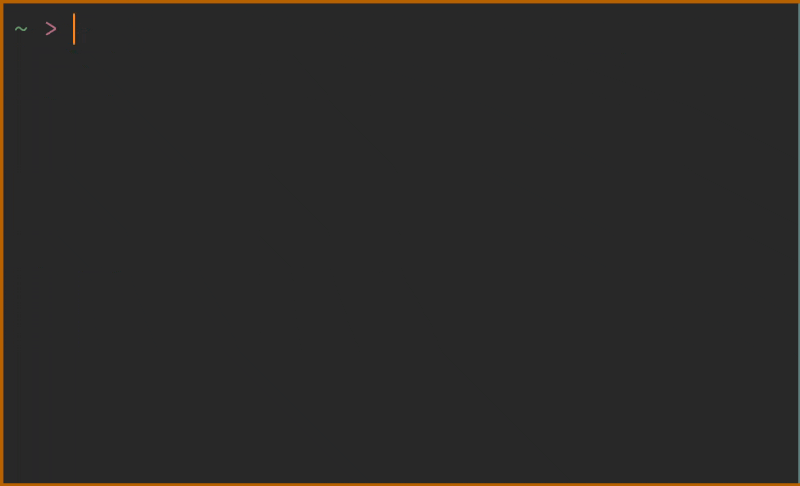

# Seashell

A ~~simple~~ small, interactive Unix-like shell written in C.



## Features

- **Job Control**: Foreground and background process management
- **Command execution**: Pipelines, redirections, conditional execution
  (&&/||), and background execution
- **Expansion**: Variable expansion and file globbing
- **Interactive input**: File and PATH completion, history, and a Vim-like line
  editor
- **Lua configuration**: Prompt styling, aliases, and environment exports

## Building and running

Building Seashell requires [Xmake](https://xmake.io), Lua 5.4, and unibilium.
Development headers must be available for Lua and unibilium.

On Fedora:

```zsh
sudo dnf install lua-devel unibilium-devel
```

Clone the repository:

```zsh
git clone --recurse-submodules https://github.com/Juta-clo/Seashell
cd Seashell
```

Then build and run from the project root:

```zsh
xmake
./seashell
```

## Configuration

Seashell supports reading a optional Lua configuration file at
`~/.seashell.lua`. For example to configure the prompt:

```lua
return {
    prompt = function(ctx)
        return ctx.cwd .. "$ "
    end
}
```

See [.seashell.lua](.seashell.lua) for a larger example.

## License

Seashell is licensed under the MIT License. See [LICENSE](LICENSE) for details.
